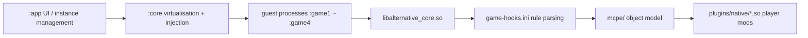

# AlterLauncher

**语言**：[中文](README.md) · English

[](LICENSE)
[](#system-requirements)
[](#supported-versions)
[](#development-environment)
[](https://github.com/answer2/AlterLauncher/issues)

A third-party launcher for Minecraft: Bedrock Edition (`com.mojang.minecraftpe`) on Android:
multi-instance and resource-pack management, Microsoft device-code sign-in, multiple simultaneous
instances, and a native mod SDK injected into the game process.

> **Unofficial project**, not affiliated with Mojang / Microsoft. It changes how the game process
> runs — judge the risk yourself. It touches login credentials and world saves, so back up before
> you start.

**Contents**: [Overview](#overview) · [Core features](#core-features) · [System requirements](#system-requirements) · [Installation](#installation) ·
[Development environment](#development-environment) · [Modules and layout](#modules-and-layout) · [Runtime flow](#runtime-flow) ·
[Version rules](#version-rules) · [Adding support for a new version](#adding-support-for-a-new-version) · [Offline toolchain](#offline-toolchain) ·
[Supported versions](#supported-versions) · [Testing](#testing) · [Usage boundaries](#usage-boundaries) · [Known gaps](#known-gaps) ·
[FAQ](#faq) · [Contributing](#contributing) · [License](#license) · [Acknowledgements](#acknowledgements) · [Contact](#contact)

---

## Overview

AlterLauncher does not replace the game binary; it starts the official package inside its own
process: instance data is isolated from itself, the sign-in state is exported to the game as XAL,
and on the native side a mod SDK driven by a **version rule file** is attached. So it is two things
at once:

- a **launcher** — multiple instances, resource-pack / plugin-pack import, Microsoft sign-in, multi-instance;
- a **native mod runtime** — mod authors drop a `.so` into the instance's `plugins/native/`, and the SDK exposes the game's object model.

The single most important design rule: **no binary offset ever enters the C++ code**. Mojang's
addresses move on every recompile; hard-coding a `+0x1c8` means the next release turns it into
"read an object that looks plausible but is wrong". Offsets, signatures and vtable slots all live in
data files, so covering a new version is a text edit, not a redesign.

## Core features

| Capability | Description |
| --- | --- |
| Multi-instance and resources | Install / import Bedrock packages, resource packs, plugin packs; each instance gets its own data directory |
| Microsoft sign-in | Device-code flow as the primary path, WebView as an optional fallback; the session is exported as XAL for the game to consume |
| Multiple instances | Launches the four game slots `:game1`–`:game4` at once, with handles, directories and instance state isolated per slot |
| Native mod SDK | Injects `libalternative_core.so`, loads `plugins/native/*.so` per instance (falling back to the shared directory when there is no instance) |
| Data-driven offsets | Rule file `game-hooks.ini` + a four-rung lookup ladder + fail-closed |
| Self-test | Send `666` in game to run one SDK self-test, reporting handles, world→screen, projection matrices and component enumeration item by item |
| No root required | There is no `su` call anywhere in the code path; virtualisation happens inside the app's own process |

## System requirements

| Item | Requirement |
| --- | --- |
| Device | Android 8.0 (API 26) or newer, arm64-v8a or armeabi-v7a |
| Game | An official Minecraft Bedrock install package (APK), within the range the rule table covers |
| Sign-in | A usable Microsoft account (entitlement checks go through Xbox Live) |
| root | Not required |

## Installation

The repository publishes no prebuilt packages; build from source:

```bash
./gradlew :app:assembleDebug          # output in app/build/outputs/apk/debug/
./gradlew :app:assembleDebug -Pabi32  # 32-bit companion package, see next section
```

After installing, follow the on-screen prompts to import the Bedrock package, create an instance,
then sign in with the device-code flow.

## Development environment

Requires the Android SDK (its local path goes in `local.properties`, which is **not** committed)
and the NDK; Gradle 8.12 / AGP 8.8.

```bash
./gradlew :app:assembleDebug                  # 64-bit, com.answer.launcher
./gradlew :app:assembleDebug -Pabi32          # 32-bit companion com.answer.launcher.x32, output in app/build-x32/
./gradlew :app:assembleArm32Debug             # equivalent entry (re-runs -Pabi32 internally)
```

The `-Pabi32` variant has its own package name and its own output directory, and coexists with the
64-bit package. Do **not** mix a plain `assembleDebug` with `assembleArm32Debug` in the same
invocation — the nested build reuses intermediate artifacts in place and has historically produced
APKs with missing classes. Run them serially.

## Modules and layout

```
:app     UI and instance management (com.answer.launcher)
:core    injection, hooks, XAL export, process/data isolation (com.answer.launcher.core)
:auth    Microsoft sign-in and session (com.answer.launcher.auth)
:api     the public API for mod authors (com.answer.api)
:cpp     native side, libalternative_core.so
:stub    helper module for hosting (placeholder Activity/Service/Provider/Receiver classes)
```

```
core/src/main/assets/game-hooks.ini   version rule file (the only source of offsets)
cpp/src/main/cpp/api                  the C interface for mod authors
cpp/src/main/cpp/mcpe/                game object model: actor / client / world / inventory / network
cpp/src/main/cpp/memory/              RTTI lookup, signature scanning, rule parsing
cpp/src/main/cpp/hook/                installation and interception (includes the `666` self-test entry)
cpp/src/test/                         host tests for pure logic, run_tests.sh
docs/                                 design documents (multi-instance concurrency, native mod protocol, plugin development, Levi compatibility)
aosp16-src/BRIEF-*.md                 measured notes on the Android 16 framework (the AOSP sources themselves are not committed)
LICENSE / NOTICE / LICENSES/          GPL-3.0-or-later + third-party licence inventory
```

## Runtime flow



## Version rules

`libminecraftpe.so` is stripped and its addresses move on every release. So offsets live not in code
but in the packaged asset `core/src/main/assets/game-hooks.ini`: `[rule]` blocks split by version
range, each carrying four kinds of key (**the authoritative format specification is in that file's
own header comment**):

| Key | Meaning | Example |
| --- | --- | --- |
| `off.<key>` | A function's RVA inside the `.so`, copied straight out of the disassembly; when present no scan is needed, but it only applies to the build it came from | `off.actorGetHealth = 0xec9b700` |
| `sig.<key>` | IDA-style byte signature, `?`/`??` wildcard half or one byte; only for **non-virtual functions** (RTTI cannot reach them) | `sig.pauseMenuOpen = ? ? ? D1 …` |
| `vtable.<key>` | `<Class>:<slot>`; at runtime RTTI finds the class → typeinfo → primary vtable → `16 + 8*slot`. Independent of bytes, so it survives recompiles | `vtable.isShowingMenu = ClientInstance:150` |
| `dat.<key>` | An offset **inside a heap object** (not inside the `.so`); the `d` prefix on the value is mandatory, because it keeps the two kinds of number from being mixed | `dat.actorEntityContextField = d0x10` |

Lookup proceeds down a **ladder**, and the order is both a correctness and a cost requirement:

```
pin (a verified fixed value) → signature (byte scan) → read-only structural scan (read-only structural probe) → virtual (call a virtual function only last)
```

If any rung does not hold, it returns failure (fail-closed): **better for a feature to not exist than
to dereference or virtually call through a guessed offset/slot.** Slot numbers from reference
implementations routinely do not line up with this build, and misplaced slots crashed the game
process twice — that is where this discipline comes from. For the same reason, the public API returns
`false` for anything unproven rather than a guess.

## Adding support for a new version

When Mojang ships a version and some feature starts returning failure, follow this chain:

1. Obtain that version's `libminecraftpe.so` (extracted from your own install package) and put it in the local `build/mc/` — that directory is not committed.
2. Add or edit a `[rule]` block in `game-hooks.ini`, stating the `min` / `max` version window.
3. Prefer `vtable.*` and `off.*`; use `sig.*` only for non-virtual functions; use `dat.*` for offsets inside objects, and the value must carry the `d` prefix.
4. Run the offline gates (next section): a signature must hit **exactly once** in the sample, and a vtable slot must fall within the real vtable's length.
5. Install, send `666` in game, and check the `AlterSelfTest` log to confirm the handles and field reads match what is on the device.
6. State where every number came from: measured on this build (tool output / device log) or a second-party reference. **Guessed values must not enter `dat.*`** —
   a pin with a right name and a wrong pointer is far more dangerous than a missing one, because everything downstream believes it.

## Offline toolchain

`tools/sdk-re/` and `build/` are both **local-only: neither committed nor distributed** — the former
holds the reverse-engineering and gate scripts, the latter the scratch area (samples, IDA databases,
one-off scripts). `tools/sdk-re/` stays out of the repository because its outputs — symbol names,
per-slot vtable contents and addresses exported from the game binary — are derived data from a
commercial game and do not belong in this distribution, and because the scripts carry the author's
own absolute paths. The table below states what question each script answers; readers who need to
reproduce the workflow can implement equivalent gates from these descriptions.

| Script | The question it answers |
| --- | --- |
| `inicheck.py` | How many times each `sig.` in the ini hits the given `.so`: 0 = stale, >1 = ambiguous and unusable |
| `gap_report.py` | Keys actually requested by the code vs keys defined in the ini, listing the gaps (those features die silently on that version) |
| `check_rules.py` | Every `vtable.*` pin checked against a real vtable dump: `CLASS_ABSENT` / `NULL_SLOT` / `PURE_STUB` / `SLOT_MOVED` / `OK` |
| `elfso.py` · `rtti_scan.py` · `vtable_getters.py` · `why_missing.py` | ELF segment layout, locating RTTI class names/tables, reading every "trivial field getter" slot in a vtable into a field table, and which link breaks when "the class name is clearly in the binary but the scan finds nothing" |
| `adrp_refs.py` · `mcfunc.py` · `ehframe.py` | Find ADRP sites referencing an address (→ constructor → field offset), disassemble a function body, function boundaries from `.eh_frame` |
| `ida_*.py` | Export names/signatures/vtables with headless IDA |

## Supported versions

The `[rule]` blocks cover `1.21.91` / `1.21.101` / `1.26.30`–`1.26.50`; the day-to-day verification
device runs **1.26.45.1**, and 1.26.52.3 exists as an offline comparison sample. Coverage is defined
by the blocks in the ini: a block with no sample to compare against is flagged `UNVERIFIED` by the
local gate script (`build/verify_rulefile.py`, a scratch-area script, not committed) to tell you it is
only a transcription — we do not backfill it with numbers from another version.

## Testing

```bash
cpp/src/test/run_tests.sh              # default: NDK aarch64 cross-compile + run on a connected device
cpp/src/test/run_tests.sh --desktop    # desktop clang++/g++ (needs a host libc++/libstdc++)
```

The pure-logic parts (rule parsing, signature scanning, RTTI/vtable address arithmetic) need no game
running. On-device regression is triggered by sending `666` in chat, which runs one SDK self-test
(`cpp/src/main/cpp/hook/GameHooks.cpp`) under the log tag `AlterSelfTest`. A test guarding a semantic
fix must additionally be run once **on a copy with that fix reverted**, to show it really fails at the
expected assertion; a test that passes on both sides is not evidence.

## Usage boundaries

**Allowed**: managing Bedrock packages and accounts you obtained legitimately, developing mods on your
own devices / your own instances, and publishing your own plugins per `docs/plugin-development.md`.

**Not allowed**: distributing the game binary or downloading it for others, bypassing entitlement
checks, using the SDK for multiplayer cheating, or passing this project's output off as the official
launcher.

## Known gaps

The rule-key gaps are **quantifiable** — output of the local (uncommitted) `tools/sdk-re/gap_report.py` as of 2026-10:

```
vtable  wanted=65 defined=25   sig  wanted=11 defined=14   dat  wanted=83 defined=29   off  wanted=2 defined=4
```

That is, the code requests 83 offsets inside objects and only 26 are actually pinned; virtual slots
are the same story. Per public interface:

| Interface | Status | What blocks it |
| --- | --- | --- |
| `Actor::getHealth` / `getMaxHealth` / armour values | returns failure | The game's own getter returns 0 on a live local player, so the **semantics are unproven** and it is not published; the on-screen health is also not inside the Actor's first 32 KiB |
| `getRegion` / `getLevel` / `getCamera` | partial / failure | The old pin `Actor+0x1c8` has measurably rotted into a different object; the `LevelRendererCamera` route requires a rendering hook, which is a feature change rather than a probe |
| `getRuntimeID` / `getUniqueID` | returns failure | On this version the corresponding virtual slots on `Actor` are empty entt ECS stubs (e.g. `mov x0,#-1`) |
| Some `Player` / `GameMode` / inventory interfaces | returns failure | See the MISSING list from `gap_report.py` |

These are deliberate blanks, not hidden bugs: callers get `false`, not a plausible wrong value.

## FAQ

**Why does some SDK function return false on my version?**
The key it needs is either undefined in the current `[rule]` block, or defined but not confirmed by a
sample. When the next rung of the ladder cannot recover it either, fail-closed is the designed
behaviour. Running `gap_report.py` shows whether a key is missing.

**Can I just copy offsets from another version?**
No. Offsets move on recompile, and copied slots crashed the process outright. Add a block and verify
it through the previous section's flow.

**How do I triage a crash after injection?**
Start with `adb logcat -s Alternative_Core AlterSelfTest`: every handle resolution carries a
provenance tag (`pin`/`sig`/`scan`/`vcall`…), and the crash site is almost always some offset that was
trusted wrongly. Temporarily deleting the suspect `dat.*` and reproducing once is the fastest way to
confirm whether it is the culprit.

**Why not just hook the game's exported symbols?**
All 90k+ symbols in `.dynsym` belong to third-party libraries (v8/cohtml/webrtc/openssl…), **not one
is a game function**. There are only two routes to a game function: RTTI type names, and cross-references
to absolute addresses.

## Contributing

The bar is **evidence**, not plausibility:

1. Any offset/slot states its provenance (measured on this build, or a second-party reference); guessed values must not enter `dat.*`.
2. Before committing, run the gates in the local `tools/sdk-re/` (not distributed) and `cpp/src/test/run_tests.sh`.
3. A regression test for a semantic fix must be shown to **actually fail** on a copy with the fix reverted.
4. Do not reshuffle unrelated files in passing; leave the reference databases and sidecars under `build/mc/` as they are.
5. Commit messages are one Chinese line saying what changed and why, attributed to the project author alone.

## License

AlterLauncher's original code is released under the **GNU General Public License v3.0 or later**
(GPL-3.0-or-later); the full text is in [`LICENSE`](LICENSE).

The project includes or derives from third-party works, each keeping its own licence, listed item by
item in [`NOTICE`](NOTICE): parts of the rule data in `game-hooks.ini` derive from
LiteLDev/preloader-android (Apache-2.0); the XAL and instance-import design references
LiteLDev/LeviLaunchroid (Apache-2.0); `:auth` depends on RaphiMC/MinecraftAuth (LGPL-3.0, published as
a separately replaceable module); the native side links bytedance/android-inline-hook's shadowhook
2.0.1 (LGPL-3.0 with a linking exception, and the prebuilt `.so` is likewise separately replaceable).
`aosp16-src/BRIEF-android16-virtualization.md` is this project's measured notes on the Android 16
framework; the AOSP source files it cites are Apache-2.0 and are not distributed from this repository.

Combining GPL-3.0 with the Apache-2.0 / LGPL-3.0 components above and publishing the result as a
whole work is compatible; the copyright and licence notices of the Apache-2.0 derived parts are
retained under GPL section 7.

This repository contains **no** Minecraft binary, game asset or account data — import the game
package you already obtained legitimately yourself.

## Acknowledgements

- **LiteLDev / LeviMC** — LeviLaunchroid and preloader-android, one source of this project's design and rule data.
- **RaphiMC** — MinecraftAuth.
- **ByteDance shadowhook** — the native hooking substrate.
- **BedrockTools and the Bedrock RE communities** — historical reference for class names and vtable structures (numbers adopted only after re-measuring on this build).
- **AOSP** — Android 16 framework sources, the ground truth for the virtualisation path.

## Contact

- Repository: <https://github.com/answer2/AlterLauncher>
- Issues and feature requests: please open a [GitHub Issue](https://github.com/answer2/AlterLauncher/issues),
  attaching logs (`adb logcat -s Alternative_Core AlterSelfTest`) and the game version.
