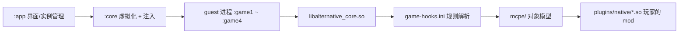

# AlterLauncher

**语言**：中文 · [English](README.en.md)

[](LICENSE)
[](#系统要求)
[](#支持版本)
[](#开发环境)
[](https://github.com/answer2/AlterLauncher/issues)

Android 上的 Minecraft: Bedrock Edition（`com.mojang.minecraftpe`）第三方启动器：多实例与资源包管理、
微软设备码登录、多开，以及一个注入进游戏进程的原生 mod SDK。

> **非官方项目**，与 Mojang / Microsoft 无关。它改变游戏进程的运行方式，请自行判断风险；
> 涉及登录凭据与世界存档，动手前先备份。

**目录**：[简介](#简介) · [核心特性](#核心特性) · [系统要求](#系统要求) · [安装](#安装) ·
[开发环境](#开发环境) · [模块与目录](#模块与目录) · [运行时流程](#运行时流程) ·
[版本规则](#版本规则) · [给新版本加支持](#给新版本加支持) · [离线工具链](#离线工具链) ·
[支持版本](#支持版本) · [测试](#测试) · [使用边界](#使用边界) · [已知未完成](#已知未完成) ·
[常见问题](#常见问题) · [贡献指南](#贡献指南) · [许可](#许可) · [致谢](#致谢) · [联系](#联系)

---

## 简介

AlterLauncher 不替换游戏二进制，而是在自己的进程内把官方安装包拉起来：实例数据互相隔离，登录态以 XAL
形式导出给游戏，原生侧再挂上一个由**版本规则文件**驱动的 mod SDK。所以它同时是两样东西：

- 一个**启动器**——多实例、资源包/插件包导入、微软登录、多开；
- 一个**原生 mod 运行时**——mod 作者把 `.so` 放进实例的 `plugins/native/`，SDK 暴露游戏对象模型。

设计上最重要的一条：**任何二进制偏移都不进 C++ 代码**。Mojang 每次重编译地址都会挪，代码里硬写一个
`+0x1c8`，下次发布它就变成"读到一个看起来合理的错对象"。偏移、特征码、虚表槽位全部放在数据文件里，
覆盖新版本是一次文本编辑，不是一次重新设计。

## 核心特性

| 能力 | 说明 |
| --- | --- |
| 多实例与资源 | 安装/导入基岩版安装包、资源包、插件包；每个实例一套独立数据目录 |
| 微软登录 | 设备码（device-code）流程为主，WebView 为可选回退；登录态导出为 XAL 给游戏使用 |
| 多开 | 一次拉起 `:game1`–`:game4` 四个游戏槽位，句柄/目录/实例状态互相隔离 |
| 原生 mod SDK | 注入 `libalternative_core.so`，按实例加载 `plugins/native/*.so`（无实例时回落共享目录） |
| 数据驱动偏移 | 规则文件 `game-hooks.ini` + 四级查找阶梯 + fail-closed |
| 自检 | 游戏里发 `666` 跑一次 SDK 自检，逐项报告句柄、world→screen、投影矩阵、组件枚举 |
| 不需要 root | 代码路径里没有 `su` 调用，虚拟化在应用自身进程内完成 |

## 系统要求

| 项目 | 要求 |
| --- | --- |
| 设备 | Android 8.0（API 26）及以上，arm64-v8a 或 armeabi-v7a |
| 游戏 | 官方 Minecraft Bedrock 安装包（APK），版本落在规则表覆盖区间内 |
| 登录 | 可用的 Microsoft 账户（正版验证走 Xbox 生活认证） |
| root | 不需要 |

## 安装

仓库不发布预编译包，从源码构建：

```bash
./gradlew :app:assembleDebug          # 输出 app/build/outputs/apk/debug/
./gradlew :app:assembleDebug -Pabi32  # 32 位伴生包，见下一节
```

装上后按界面提示导入基岩版安装包、创建实例，再用设备码登录。

## 开发环境

需要 Android SDK（本地路径写进**不入库**的 `local.properties`）与 NDK；Gradle 8.12 / AGP 8.8。

```bash
./gradlew :app:assembleDebug                  # 64 位，com.answer.launcher
./gradlew :app:assembleDebug -Pabi32          # 32 位伴生包 com.answer.launcher.x32，输出在 app/build-x32/
./gradlew :app:assembleArm32Debug             # 等价入口（内部再跑一次 -Pabi32）
```

`-Pabi32` 变体独立包名、独立输出目录，可与 64 位包共存。**不要**在同一次 invocation 里把普通
`assembleDebug` 与 `assembleArm32Debug` 混着跑——嵌套构建会原地复用中间产物，历史上产出过缺类的 APK；
串行执行即可。

## 模块与目录

```
:app     界面与实例管理（com.answer.launcher）
:core    注入、Hook、XAL 导出、进程/数据隔离（com.answer.launcher.core）
:auth    微软登录与会话（com.answer.launcher.auth）
:api     面向 mod 作者的公开 API（com.answer.api）
:cpp     原生侧 libalternative_core.so
:stub    承载用的辅助模块（Activity/Service/Provider/Receiver 占位类）
```

```
core/src/main/assets/game-hooks.ini   版本规则文件（唯一的偏移来源）
cpp/src/main/cpp/api                  mod 作者的 C 接口
cpp/src/main/cpp/mcpe/                游戏对象模型：actor / client / world / inventory / network
cpp/src/main/cpp/memory/              RTTI 查找、签名扫描、规则解析
cpp/src/main/cpp/hook/                安装与拦截（含 `666` 自检入口）
cpp/src/test/                         纯逻辑宿主测试，run_tests.sh
docs/                                 设计文档（多开并发、native mod 协议、插件开发、Levi 兼容）
aosp16-src/BRIEF-*.md                 Android 16 framework 的实测笔记（AOSP 源码本身不入库）
LICENSE / NOTICE / LICENSES/          GPL-3.0-or-later + 第三方许可清单
```

## 运行时流程



## 版本规则

`libminecraftpe.so` 是 stripped 的，每次发布地址都挪。所以偏移不写在代码里，而在随包资源
`core/src/main/assets/game-hooks.ini`：按版本区间分 `[rule]` 块，每块给四类键（**完整格式规范写在该文件
自己的头部注释里，那是权威版本**）：

| 键 | 含义 | 例子 |
| --- | --- | --- |
| `off.<key>` | 函数在 `.so` 内的 RVA，直接抄自反汇编；有它就不必扫描，但只适用于它出身的那个构建 | `off.actorGetHealth = 0xec9b700` |
| `sig.<key>` | IDA 风格字节特征码，`?`/`??` 通配半个或一个字节；只用于**非虚函数**（RTTI 到不了） | `sig.pauseMenuOpen = ? ? ? D1 …` |
| `vtable.<key>` | `<Class>:<slot>`，运行时靠 RTTI 找类→typeinfo→主虚表→`16 + 8*slot`；不依赖字节，重编译后仍然活 | `vtable.isShowingMenu = ClientInstance:150` |
| `dat.<key>` | **堆对象内部**的偏移（不是 `.so` 内部），值的 `d` 前缀必需，它防止两类数字互相混用 | `dat.actorEntityContextField = d0x10` |

查找按**阶梯**进行，顺序既是正确性要求也是开销要求：

```
pin（已验证的固定值）→ signature（特征码扫描）→ read-only structural scan（只读结构探测）→ virtual（最后才调虚函数）
```

任何一级不成立就返回失败（fail-closed）：**宁可一个功能不存在，也不拿着猜测的偏移/槽位去解引用或发起虚调用**。
参考实现的槽位号经常与本构建错位，错位槽位曾两次直接把游戏进程搞崩——这条纪律就是这么来的。
同理，公开 API 对未证实的东西返回 `false`，不返回猜测值。

## 给新版本加支持

Mojang 发了新版本、某功能开始返回失败时，走这条链：

1. 拿到该版本的 `libminecraftpe.so`（从你自己的安装包解出），放进本地 `build/mc/`——该目录不入库。
2. 在 `game-hooks.ini` 里加/改一个 `[rule]` 块，写清 `min` / `max` 版本窗口。
3. 先用 `vtable.*` 与 `off.*`，只有非虚函数才用 `sig.*`；对象内偏移用 `dat.*`，值必须带 `d` 前缀。
4. 跑离线门禁（下一节）：特征码要在样本里**唯一命中**，虚表槽位要落在真实虚表的长度内。
5. 装机，进游戏发 `666`，看 `AlterSelfTest` 日志确认句柄与字段读出的值和现场一致。
6. 每个数字注明来源：本构建实测（工具输出/设备日志）还是第二方参考。**猜测值不得进 `dat.*`**——
   一个名字对、指针错的 pin 比缺失的 pin 危险得多，它会让下游全都信它。

## 离线工具链

`tools/sdk-re/` 与 `build/` 都是**本地专用，不入库、不分发**：前者是逆向与门禁脚本，后者是草稿区
（样本、IDA 数据库、一次性脚本）。`tools/sdk-re/` 不入库的原因是它的产物——从游戏二进制导出的符号名、
vtable 逐槽内容与地址——属于商业游戏的衍生数据，不适合随本仓库分发；脚本里也带作者本机的绝对路径。
下面这张表说明这些脚本各自回答什么问题，需要复现流程的读者按描述自行实现同等门禁。

| 脚本 | 它回答的问题 |
| --- | --- |
| `inicheck.py` | ini 里每条 `sig.` 在指定 `.so` 里命中几次：0 = 已过时，>1 = 有歧义、不可用 |
| `gap_report.py` | 代码里实际请求的键 vs ini 里定义的键，列出缺口（这些功能在该版本静默死亡） |
| `check_rules.py` | 每个 `vtable.*` pin 对照真实虚表 dump：`CLASS_ABSENT` / `NULL_SLOT` / `PURE_STUB` / `SLOT_MOVED` / `OK` |
| `elfso.py` · `rtti_scan.py` · `vtable_getters.py` · `why_missing.py` | ELF 段布局、RTTI 类名/表定位、把虚表里所有"平凡取字段"的槽位读成字段表、以及"类名明明在二进制里却扫不到"断在哪一环 |
| `adrp_refs.py` · `mcfunc.py` · `ehframe.py` | 找引用某个地址的 ADRP 站点（→构造函数→字段偏移）、反汇编函数体、`.eh_frame` 函数边界 |
| `ida_*.py` | 配合 IDA headless 导出名字/特征/虚表 |

## 支持版本

`[rule]` 块覆盖 `1.21.91` / `1.21.101` / `1.26.30`–`1.26.50`；日常验证设备跑 **1.26.45.1**，
离线对照样本另有 1.26.52.3。覆盖与否以 ini 里的块为准：没有样本可比对的块会被本地门禁脚本
（`build/verify_rulefile.py`，草稿区脚本、不入库）标成 `UNVERIFIED` 提示你它只是照抄来的，
我们不会拿别的版本的数字硬填。

## 测试

```bash
cpp/src/test/run_tests.sh              # 默认：NDK aarch64 交叉编译 + 连设备运行
cpp/src/test/run_tests.sh --desktop    # 桌面 clang++/g++（需宿主 libc++/libstdc++）
```

纯逻辑部分（规则解析、特征码扫描、RTTI/vtable 地址点）不需要游戏在跑。
真机回归由聊天里的 `666` 触发一次 SDK 自检（`cpp/src/main/cpp/hook/GameHooks.cpp`），日志 tag
`AlterSelfTest`。守护某个语义修复的测试，要额外在**把该修复撤掉的副本**上跑一次，确认它确实在预期的断言处失败；
两边都通过的测试不算证据。

## 使用边界

**允许**：管理自己已合法获得的基岩版安装包与账户、在自己的设备/自己的实例上做模组开发、
按 `docs/plugin-development.md` 发布自建插件。

**不允许**：分发游戏二进制或替他人下载、绕过正版验证、把 SDK 用于联机作弊、把本项目产物冒充官方启动器。

## 已知未完成

规则键的缺口是**可量化**的——本地 `tools/sdk-re/gap_report.py`（不入库）在 2026-10 的输出：

```
vtable  wanted=65 defined=25   sig  wanted=11 defined=14   dat  wanted=83 defined=29   off  wanted=2 defined=4
```

即代码请求了 83 个对象内偏移，只有 26 个真正钉住了；虚函数槽位同理。落到具体接口上：

| 接口 | 现状 | 卡在哪 |
| --- | --- | --- |
| `Actor::getHealth` / `getMaxHealth` / 护甲值 | 返回失败 | 游戏自己的 getter 在活着的本地玩家身上恒返回 0，**语义未证实**，所以不对外发布；屏幕上的血量也不在 Actor 对象的前 32 KiB 内 |
| `getRegion` / `getLevel` / `getCamera` | 部分/失败 | 旧 pin `Actor+0x1c8` 实测已腐烂成别的对象；`LevelRendererCamera` 那条路线要挂渲染 hook，属于功能变更而非探测 |
| `getRuntimeID` / `getUniqueID` | 返回失败 | 该版本 `Actor` 上对应虚槽是 entt ECS 的空 stub（如 `mov x0,#-1`） |
| 部分 `Player` / `GameMode` / 物品栏接口 | 返回失败 | 见 `gap_report.py` 的 MISSING 列表 |

这些都是有意留白，不是隐藏 bug：调用方拿到的是 `false`，不是一个看起来合理的错值。

## 常见问题

**为什么某个 SDK 函数在我的版本上返回 false？**
它需要的那个键在当前 `[rule]` 块里没有定义，或有定义但没被样本证实。阶梯的下一级也补不出来时，
fail-closed 就是设计行为。跑 `gap_report.py` 能看到它是不是缺键。

**我能不能照着别的版本的偏移直接抄？**
不能。偏移会随重编译挪动，抄来的槽位曾让进程直接崩。加块、按上一节的流程验证。

**怎么定位一次注入后崩溃？**
先看 `adb logcat -s Alternative_Core AlterSelfTest`：句柄解析每一项都带 provenance 标签
（`pin`/`sig`/`scan`/`vcall`…），崩溃点几乎总在某个被误信的偏移上。
把可疑的 `dat.*` 暂时删掉再复现一次，是确认它是不是元凶最快的办法。

**为什么不直接 hook 游戏的导出符号？**
`.dynsym` 里 9 万多个符号全是第三方库的（v8/cohtml/webrtc/openssl…），**没有一个游戏函数**。
到游戏函数的路只有两条：RTTI 类型名，和绝对地址交叉引用。

## 贡献指南

门槛是**证据**，不是看起来合理：

1. 任何偏移/槽位写清来源（本构建实测 or 第二方参考）；猜测值不得进 `dat.*`。
2. 提交前跑本地 `tools/sdk-re/` 的门禁（脚本不入库）与 `cpp/src/test/run_tests.sh`。
3. 语义修复的回归测试必须展示它在撤掉修复的副本上**确实失败**。
4. 不顺手重排无关文件；`build/mc/` 下的参考数据库与 sidecar 保持原样。
5. 提交信息一行中文说明"改了什么/为什么"，署名只带项目作者本人。

## 许可

AlterLauncher 的原创代码在 **GNU General Public License v3.0 or later**（GPL-3.0-or-later）下发布，
全文见 [`LICENSE`](LICENSE)。

项目包含或派生自第三方作品，各自保留自己的许可，逐条列在 [`NOTICE`](NOTICE)：
`game-hooks.ini` 的部分规则数据派生自 LiteLDev/preloader-android（Apache-2.0）；XAL 与实例导入的设计参考
LiteLDev/LeviLaunchroid（Apache-2.0）；`:auth` 依赖 RaphiMC/MinecraftAuth（LGPL-3.0，以独立可替换模块发布）；
原生侧链接 bytedance/android-inline-hook 的 shadowhook 2.0.1（LGPL-3.0 带链接例外，预构建 `.so` 同样可单独替换）。
`aosp16-src/BRIEF-android16-virtualization.md` 是本项目对 Android 16 framework 的实测笔记，其中引用的 AOSP
源文件本身是 Apache-2.0，不在本仓库分发。

GPL-3.0 与上述 Apache-2.0 / LGPL-3.0 组件的组合作为整体作品发布是兼容的；Apache-2.0 派生部分的版权与许可
声明按 GPL 第 7 条保留。

本仓库**不含**任何 Minecraft 二进制、游戏资源或账号数据——请自己导入你已合法获得的游戏安装包。

## 致谢

- **LiteLDev / LeviMC** — LeviLaunchroid 与 preloader-android，本项目设计与规则数据来源之一。
- **RaphiMC** — MinecraftAuth。
- **字节跳动 shadowhook** — 原生 hook 底座。
- **BedrockTools 及各基岩版逆向社区** — 类名与虚表结构的历史参考（数字一律本构建复测后才采用）。
- **AOSP** — Android 16 framework 源码，虚拟化路径的地面真值。

## 联系

- 仓库：<https://github.com/answer2/AlterLauncher>
- 问题与新需求：请在 [GitHub Issues](https://github.com/answer2/AlterLauncher/issues) 提出，
  附上日志（`adb logcat -s Alternative_Core AlterSelfTest`）与游戏版本。
